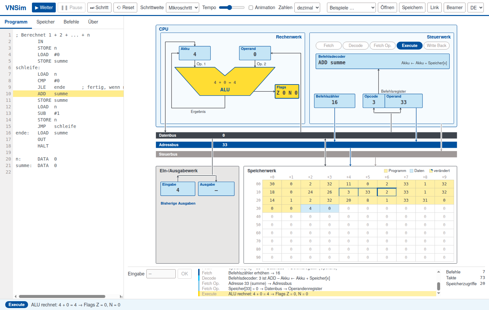

# VNSim – Von-Neumann-Simulator

*[English version](README.md)*

**▶ Ausprobieren: <https://sc-sgs.github.io/vnsim/>** (ohne Installation, läuft in jedem aktuellen Browser)

VNSim ist ein interaktiver Modellrechner für die Lehre. Ein einfacher Von-Neumann-Rechner mit
Akkumulator wird als Schaubild dargestellt; jeder Befehl läuft sichtbar in den fünf Phasen
**Fetch → Decode → Fetch Operands → Execute → Write Back** als Folge von Mikroschritten ab,
und die Werte wandern über Daten-, Adress- und Steuerbus.

Entstanden im Rahmen der Vorlesung „Informatik für Ingenieurwissenschaften“ an der Universität Stuttgart.

Die Oberfläche gibt es auf **Deutsch und Englisch** (Umschalter oben rechts oder `?lang=de` /
`?lang=en` in der Adresse).



## Funktionen

- Programm und Daten liegen im **selben Speicher** (Von-Neumann-Prinzip) – Programme können sich sogar selbst verändern.
- Ausführung in Mikroschritten, Phasen oder Befehlen, oder als Dauerlauf mit einstellbarem Tempo und Animation.
- Speicherzellen direkt bearbeiten; eine Spalte zeigt, wie jede Zelle als Befehl gelesen wird.
- Zahlen dezimal, hexadezimal oder binär (16-Bit-Zweierkomplement).
- Zähler für Befehle, Takte (Mikroschritte) und Speicherzugriffe – zum Vergleich der Kosten von Programmen.
- Programme als Link teilen (`…/vnsim/#p=…`), z. B. auf Folien, als QR-Code oder auf Übungsblättern.
- Beispielprogramme: Ausdruck aus der Vorlesung, Maximum, Countdown, Summe 1 … n, Fakultät,
  selbstmodifizierende Listensumme.
- Beamer-Modus (Taste **P**).
- Läuft offline: einfach `index.html` öffnen – kein Build, keine Abhängigkeiten.

## Maschine

- 100 Speicherzellen (Adressen 0 … 99), jede mit einer ganzen Zahl von −9999 bis 9999.
- Ein Befehl belegt zwei Zellen (Opcode, Operand).
- Register: Akku, Operandenregister, Flags **Z** (null) und **N** (negativ), Befehlszähler,
  Befehlsregister, Ein- und Ausgaberegister.

### Befehlssatz

| Code | Befehl | Wirkung | setzt |
|---|---|---|---|
| 00 | `HALT` | Programm anhalten |  |
| 01 | `LOAD x` | Akku ← Speicher[x] |  |
| 11 | `LOAD #n` | Akku ← n |  |
| 02 | `STORE x` | Speicher[x] ← Akku |  |
| 03 | `ADD x` | Akku ← Akku + Speicher[x] | Z N |
| 13 | `ADD #n` | Akku ← Akku + n | Z N |
| 04 | `SUB x` | Akku ← Akku − Speicher[x] | Z N |
| 14 | `SUB #n` | Akku ← Akku − n | Z N |
| 05 | `MUL x` | Akku ← Akku · Speicher[x] | Z N |
| 15 | `MUL #n` | Akku ← Akku · n | Z N |
| 06 | `DIV x` | Akku ← Akku // Speicher[x] | Z N |
| 16 | `DIV #n` | Akku ← Akku // n | Z N |
| 07 | `MOD x` | Akku ← Akku % Speicher[x] | Z N |
| 17 | `MOD #n` | Akku ← Akku % n | Z N |
| 08 | `CMP x` | Flags ← Akku − Speicher[x] (Akku bleibt) | Z N |
| 18 | `CMP #n` | Flags ← Akku − n (Akku bleibt) | Z N |
| 20 | `JMP ziel` | Springe immer |  |
| 21 | `JE ziel` | Springe, wenn gleich (Z = 1) |  |
| 22 | `JNE ziel` | Springe, wenn ungleich (Z = 0) |  |
| 23 | `JL ziel` | Springe, wenn kleiner (N = 1) |  |
| 24 | `JLE ziel` | Springe, wenn kleiner oder gleich (N = 1 oder Z = 1) |  |
| 25 | `JG ziel` | Springe, wenn größer (N = 0 und Z = 0) |  |
| 26 | `JGE ziel` | Springe, wenn größer oder gleich (N = 0) |  |
| 30 | `IN` | Akku ← Eingabe |  |
| 31 | `OUT` | Ausgabe ← Akku |  |

Akku = Akkumulator, Speicher[x] = Inhalt der Zelle x. DIV und MOD rechnen wie `//` und `%` in Python.
HALT hat den Opcode 00 – leerer Speicher hält also sofort an.

Direktwerte (`#n`) haben den Opcode + 10. Die Flags werden von ADD, SUB, MUL, DIV, MOD und CMP gesetzt,
nicht von LOAD und IN (wie `mov` bei x86).

**Ein- und Ausgabe** laufen wie alle Daten über den Akku: `IN` und dann `STORE x` speichert eine Eingabe,
`LOAD x` und dann `OUT` gibt eine Speicherzelle aus.

**Faustregel:** Vor jeden bedingten Sprung ein `CMP` setzen – dann ist klar, worauf sich der Sprung bezieht.
Weil auch die Rechenbefehle die Flags setzen, kann das `CMP` manchmal entfallen (z. B. `SUB #1` direkt vor
`JG`, siehe Beispiel „Countdown“); das spart einen Befehl, ist aber leichter zu übersehen.

### Assembler-Direktive `DATA`

`DATA` ist kein Befehl der Maschine, sondern eine Anweisung an den Assembler: `name: DATA w1, w2, …`
legt die Werte in die nächsten freien Speicherzellen; `name` ist die Adresse der ersten Zelle.
Die Maschine selbst kennt `DATA` nicht – wird eine solche Zelle als Befehl ausgeführt, gilt ihr Wert
als Opcode.

**Speicherstelle benennen:** `b: DATA 0` reserviert die nächste freie Zelle mit dem Startwert 0 und gibt
ihr den Namen `b`, ähnlich einer Variablen. Danach kann man überall `b` statt der Adresse schreiben,
z. B. `LOAD b`, `STORE b`, `ADD b`; der Assembler setzt die Adresse ein.

### Farben im Speicher

| Farbe | Bedeutung |
|---|---|
| gelb | Befehl (Opcode, Operand) – vom Assembler erzeugt oder zur Laufzeit als Befehl geholt |
| blau | Daten – mit `DATA` angelegt oder zur Laufzeit beschrieben (`STORE`) |
| gelb mit blauer Ecke | zur Laufzeit überschriebene Programmzelle (selbstmodifizierender Code) |

Kräftig gelb ist der Zugriff im aktuellen Mikroschritt (roter Rahmen beim Schreiben); ein dicker blauer
Rahmen zeigt die Zelle, auf die der Befehlszähler zeigt.

### Syntax

```
; Kommentar
start:  LOAD  #5      ; Direktwert
        ADD   x       ; Wert an Adresse x
        STORE 42      ; Adresse als Zahl
        STORE x+1     ; Zelle nach x
        JMP   start
x:      DATA  7, 8    ; Datenzellen
```

Eine Zahl ohne `#` ist eine **Adresse** – für die Zahl 2 `#2` schreiben (`MOD 2` rechnet mit dem Inhalt
von Zelle 2). Groß-/Kleinschreibung spielt keine Rolle; Labels stehen am Zeilenanfang und enden mit `:`.

## Bedienung

| | |
|---|---|
| **▶ Start** | läuft bis HALT (F5) |
| **⏭ Schritt** | ein Mikroschritt, eine Phase oder ein Befehl, je nach „Schrittweite“ (F10) |
| **Pause / Reset** | Leertaste / Esc |
| **Link** | kopiert eine Adresse, die das aktuelle Programm enthält |
| **Beamer** | Präsentationsmodus (P) |

Reiter links: **Programm** (Editor), **Speicher** (Zellen bearbeiten, Rückübersetzung der Befehle),
**Befehle** (Befehlsreferenz), **Über** (Informationen zum Simulator).

Das Programm wird außerdem im Browser gemerkt.

## Entwicklung

Reines HTML/CSS/JavaScript ohne Abhängigkeiten und ohne Build; `index.html` muss auch über
`file://` funktionieren. Wichtige Dateien:

| Datei | Inhalt |
|---|---|
| `js/isa.js` | Befehlstabelle |
| `js/assembler.js` | Quelltext → Speicherabbild |
| `js/machine.js` | Zustand und Befehlszyklus als Mikroschritte (ohne DOM) |
| `js/view.js` | SVG-Schaubild und Animation |
| `js/app.js` | Bedienoberfläche |
| `js/i18n.js` | deutsche und englische Texte |
| `js/examples.js` | Beispielprogramme (beide Sprachen) |

Tests: `tests/index.html` im Browser öffnen oder headless:

```sh
chromium --headless --dump-dom "file://$PWD/tests/index.html" | grep -o 'id="summary"[^<]*'
```

## Autor und Lizenz

Dirk Pflüger, Universität Stuttgart.

Code: [MIT-Lizenz](LICENSE). Schrift: TeX Gyre Heros, GUST Font License (siehe `fonts/`).
