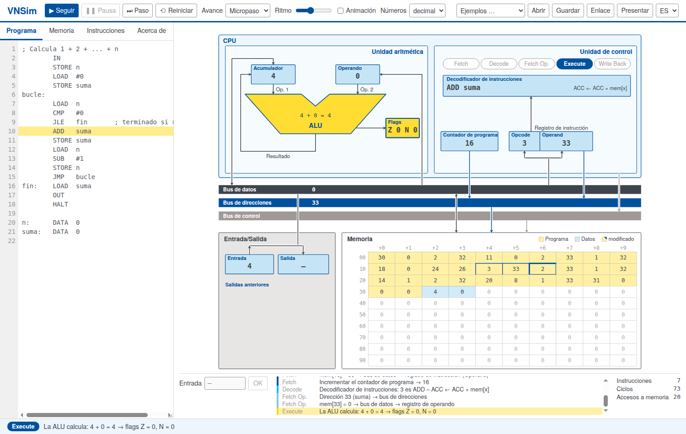

# VNSim – Simulador de von Neumann

*[English](README.md) · [Deutsch](README.de.md) · [Français](README.fr.md) · Español*

**▶ Probar: <https://sc-sgs.github.io/vnsim/?lang=es>** (sin instalación, funciona en cualquier navegador actual)

VNSim es un ordenador modelo interactivo para la enseñanza de la arquitectura de computadores. Una máquina
sencilla con acumulador, basada en la arquitectura de von Neumann, se muestra como esquema; cada instrucción
recorre de forma visible las cinco fases
**Fetch → Decode → Fetch Operands → Execute → Write Back** como una secuencia de micropasos,
y los valores viajan por el bus de datos, el bus de direcciones y el bus de control.

Desarrollado para la asignatura «Informatik für Ingenieurwissenschaften» (Informática para ingenieros)
en la Universidad de Stuttgart.

La interfaz está disponible en **inglés y alemán**, y también en francés y español (selector arriba a la
derecha, o `?lang=es`, `?lang=fr`, `?lang=en`, `?lang=de` en la dirección).



## Funciones

- Programa y datos comparten **una sola memoria** (principio de von Neumann): los programas pueden incluso modificarse a sí mismos.
- Ejecución por micropaso, por fase o por instrucción, o de forma continua con velocidad y animación ajustables.
- Las celdas de memoria se editan directamente; una columna muestra cómo se interpreta cada celda como instrucción.
- Números en decimal, hexadecimal o binario (complemento a dos de 16 bits).
- Contadores de instrucciones, ciclos de reloj (micropasos) y accesos a memoria, para comparar el coste de los programas.
- Compartir programas mediante enlaces (`…/vnsim/#p=…`), p. ej. en diapositivas, códigos QR u hojas de ejercicios.
- Programas de ejemplo: expresión de la asignatura, máximo, cuenta atrás, suma 1 … n, factorial,
  suma de una lista automodificable.
- Modo presentación para proyector (tecla **P**).
- Funciona sin conexión: basta con abrir `index.html`, sin compilación ni dependencias.

## La máquina

- 100 celdas de memoria (direcciones 0 … 99), cada una con un número entero de −9999 a 9999.
- Una instrucción ocupa dos celdas (opcode, operando).
- Registros: acumulador (ACC), registro de operando, flags **Z** (cero) y **N** (negativo),
  contador de programa, registro de instrucción, registros de entrada y de salida.

### Conjunto de instrucciones

| Código | Instrucción | Efecto | modifica |
|---|---|---|---|
| 00 | `HALT` | Detener el programa |  |
| 01 | `LOAD x` | ACC ← mem[x] |  |
| 11 | `LOAD #n` | ACC ← n |  |
| 02 | `STORE x` | mem[x] ← ACC |  |
| 03 | `ADD x` | ACC ← ACC + mem[x] | Z N |
| 13 | `ADD #n` | ACC ← ACC + n | Z N |
| 04 | `SUB x` | ACC ← ACC − mem[x] | Z N |
| 14 | `SUB #n` | ACC ← ACC − n | Z N |
| 05 | `MUL x` | ACC ← ACC · mem[x] | Z N |
| 15 | `MUL #n` | ACC ← ACC · n | Z N |
| 06 | `DIV x` | ACC ← ACC // mem[x] | Z N |
| 16 | `DIV #n` | ACC ← ACC // n | Z N |
| 07 | `MOD x` | ACC ← ACC % mem[x] | Z N |
| 17 | `MOD #n` | ACC ← ACC % n | Z N |
| 08 | `CMP x` | Flags ← ACC − mem[x] (ACC sin cambios) | Z N |
| 18 | `CMP #n` | Flags ← ACC − n (ACC sin cambios) | Z N |
| 20 | `JMP destino` | Saltar siempre |  |
| 21 | `JE destino` | Saltar si igual (Z = 1) |  |
| 22 | `JNE destino` | Saltar si distinto (Z = 0) |  |
| 23 | `JL destino` | Saltar si menor (N = 1) |  |
| 24 | `JLE destino` | Saltar si menor o igual (N = 1 o Z = 1) |  |
| 25 | `JG destino` | Saltar si mayor (N = 0 y Z = 0) |  |
| 26 | `JGE destino` | Saltar si mayor o igual (N = 0) |  |
| 30 | `IN` | ACC ← entrada |  |
| 31 | `OUT` | salida ← ACC |  |

ACC = acumulador, mem[x] = contenido de la celda x. DIV y MOD funcionan como `//` y `%` en Python.
HALT tiene el opcode 00, así que una memoria vacía se detiene de inmediato.

Los valores inmediatos (`#n`) tienen el opcode + 10. Los flags los modifican ADD, SUB, MUL, DIV, MOD y CMP,
pero no LOAD ni IN (como `mov` en x86).

**La entrada y la salida** pasan por el acumulador como todos los datos: `IN` y luego `STORE x` guarda un
valor introducido, `LOAD x` y luego `OUT` muestra una celda de memoria.

**Regla práctica:** poner un `CMP` antes de cada salto condicional; así queda claro a qué se refiere el salto.
Como las instrucciones aritméticas también modifican los flags, a veces se puede omitir el `CMP`
(p. ej. `SUB #1` justo antes de `JG`, véase el ejemplo «Cuenta atrás»); esto ahorra una instrucción, pero es
más fácil pasarlo por alto.

### Directiva de ensamblador `DATA`

`DATA` no es una instrucción de la máquina, sino una directiva para el ensamblador: `nombre: DATA v1, v2, …`
coloca los valores en las siguientes celdas de memoria libres; `nombre` es la dirección de la primera celda.
La máquina en sí no conoce `DATA`: si una de esas celdas se ejecuta como instrucción, su valor se interpreta
como opcode.

**Dar nombre a una celda de memoria:** `b: DATA 0` reserva la siguiente celda libre con el valor inicial 0 y
le da el nombre `b`, de forma parecida a una variable. A partir de ahí se puede escribir `b` en lugar de la
dirección, p. ej. `LOAD b`, `STORE b`, `ADD b`; el ensamblador inserta la dirección.

### Colores en la memoria

| Color | Significado |
|---|---|
| amarillo | instrucción (opcode, operando), generada por el ensamblador o leída como instrucción durante la ejecución |
| azul | datos, creados con `DATA` o escritos durante la ejecución (`STORE`) |
| amarillo con esquina azul | celda de programa sobrescrita durante la ejecución (código automodificable) |

El amarillo intenso marca el acceso del micropaso actual (borde rojo al escribir); un borde azul grueso marca
la celda a la que apunta el contador de programa.

### Sintaxis

```
; comentario
inicio: LOAD  #5      ; valor inmediato
        ADD   x       ; valor en la dirección x
        STORE 42      ; dirección como número
        STORE x+1     ; la celda siguiente a x
        JMP   inicio
x:      DATA  7, 8    ; celdas de datos
```

Un número sin `#` es una **dirección**: para el número 2 hay que escribir `#2` (`MOD 2` usa el contenido de
la celda 2). No se distingue entre mayúsculas y minúsculas; las etiquetas van al principio de la línea y
terminan en `:` (letras sin tildes, cifras y `_`).

## Uso

| | |
|---|---|
| **▶ Iniciar** | ejecutar hasta HALT (F5) |
| **⏭ Paso** | un micropaso, una fase o una instrucción, según «Avance» (F10) |
| **Pausa / Reiniciar** | Espacio / Esc |
| **Enlace** | copia un enlace que contiene el programa actual |
| **Presentar** | modo presentación (P) |

Pestañas a la izquierda: **Programa** (editor), **Memoria** (editar celdas, desensamblado),
**Instrucciones** (referencia de instrucciones), **Acerca de** (información sobre el simulador).

El programa también se guarda en el almacenamiento local del navegador.

## Desarrollo

HTML, CSS y JavaScript puros, sin dependencias ni compilación; `index.html` debe funcionar también al
abrirlo mediante `file://`. Archivos principales:

| Archivo | Contenido |
|---|---|
| `js/isa.js` | tabla de instrucciones |
| `js/assembler.js` | código fuente → imagen de memoria |
| `js/machine.js` | estado de la máquina y ciclo de instrucción en micropasos (sin DOM) |
| `js/view.js` | esquema SVG y animación |
| `js/app.js` | interfaz de usuario |
| `js/i18n.js` | textos en todos los idiomas |
| `js/examples.js` | programas de ejemplo (todos los idiomas) |

Pruebas: abrir `tests/index.html` en un navegador, o en modo headless:

```sh
chromium --headless --dump-dom "file://$PWD/tests/index.html" | grep -o 'id="summary"[^<]*'
```

## Autor y licencia

Dirk Pflüger, Universidad de Stuttgart.

Código: [licencia MIT](LICENSE). Tipografía: TeX Gyre Heros, GUST Font License (véase `fonts/`).
