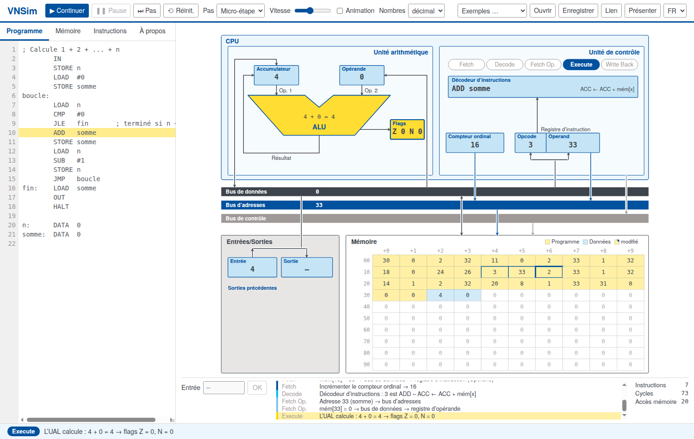

# VNSim – Simulateur de von Neumann

*[English](README.md) · [Deutsch](README.de.md) · Français · [Español](README.es.md)*

**▶ Essayer : <https://sc-sgs.github.io/vnsim/?lang=fr>** (sans installation, fonctionne dans tout navigateur récent)

VNSim est un ordinateur modèle interactif pour l’enseignement de l’architecture des ordinateurs. Une
machine simple à accumulateur, suivant l’architecture de von Neumann, est représentée sous forme de
schéma ; chaque instruction parcourt visiblement les cinq phases
**Fetch → Decode → Fetch Operands → Execute → Write Back** sous forme de micro-étapes,
et les valeurs circulent sur le bus de données, le bus d’adresses et le bus de contrôle.

Développé pour le cours « Informatik für Ingenieurwissenschaften » (informatique pour ingénieurs)
à l’Université de Stuttgart.

L’interface est disponible en **anglais et en allemand**, ainsi qu’en français et en espagnol (sélecteur
en haut à droite, ou `?lang=fr`, `?lang=es`, `?lang=en`, `?lang=de` dans l’adresse).



## Fonctionnalités

- Programme et données partagent **une seule mémoire** (principe de von Neumann) – les programmes peuvent même se modifier eux-mêmes.
- Exécution par micro-étape, par phase ou par instruction, ou en continu avec vitesse et animation réglables.
- Les cellules mémoire se modifient directement ; une colonne montre comment chaque cellule est lue comme instruction.
- Nombres en décimal, hexadécimal ou binaire (complément à deux sur 16 bits).
- Compteurs d’instructions, de cycles d’horloge (micro-étapes) et d’accès mémoire – pour comparer le coût des programmes.
- Partager des programmes par lien (`…/vnsim/#p=…`), p. ex. sur des transparents, des codes QR ou des feuilles d’exercices.
- Programmes d’exemple : expression du cours, maximum, compte à rebours, somme 1 … n, factorielle,
  somme d’une liste auto-modifiante.
- Mode présentation pour vidéoprojecteur (touche **P**).
- Fonctionne hors ligne : il suffit d’ouvrir `index.html` – sans compilation, sans dépendances.

## La machine

- 100 cellules mémoire (adresses 0 … 99), chacune contenant un nombre entier de −9999 à 9999.
- Une instruction occupe deux cellules (opcode, opérande).
- Registres : accumulateur (ACC), registre d’opérande, flags **Z** (zéro) et **N** (négatif),
  compteur ordinal, registre d’instruction, registres d’entrée et de sortie.

### Jeu d’instructions

| Code | Instruction | Effet | modifie |
|---|---|---|---|
| 00 | `HALT` | Arrêter le programme |  |
| 01 | `LOAD x` | ACC ← mém[x] |  |
| 11 | `LOAD #n` | ACC ← n |  |
| 02 | `STORE x` | mém[x] ← ACC |  |
| 03 | `ADD x` | ACC ← ACC + mém[x] | Z N |
| 13 | `ADD #n` | ACC ← ACC + n | Z N |
| 04 | `SUB x` | ACC ← ACC − mém[x] | Z N |
| 14 | `SUB #n` | ACC ← ACC − n | Z N |
| 05 | `MUL x` | ACC ← ACC · mém[x] | Z N |
| 15 | `MUL #n` | ACC ← ACC · n | Z N |
| 06 | `DIV x` | ACC ← ACC // mém[x] | Z N |
| 16 | `DIV #n` | ACC ← ACC // n | Z N |
| 07 | `MOD x` | ACC ← ACC % mém[x] | Z N |
| 17 | `MOD #n` | ACC ← ACC % n | Z N |
| 08 | `CMP x` | Flags ← ACC − mém[x] (ACC inchangé) | Z N |
| 18 | `CMP #n` | Flags ← ACC − n (ACC inchangé) | Z N |
| 20 | `JMP cible` | Sauter toujours |  |
| 21 | `JE cible` | Sauter si égal (Z = 1) |  |
| 22 | `JNE cible` | Sauter si différent (Z = 0) |  |
| 23 | `JL cible` | Sauter si inférieur (N = 1) |  |
| 24 | `JLE cible` | Sauter si inférieur ou égal (N = 1 ou Z = 1) |  |
| 25 | `JG cible` | Sauter si supérieur (N = 0 et Z = 0) |  |
| 26 | `JGE cible` | Sauter si supérieur ou égal (N = 0) |  |
| 30 | `IN` | ACC ← entrée |  |
| 31 | `OUT` | sortie ← ACC |  |

ACC = accumulateur, mém[x] = contenu de la cellule x. DIV et MOD fonctionnent comme `//` et `%` en Python.
HALT a l’opcode 00 – une mémoire vide s’arrête donc immédiatement.

Les valeurs immédiates (`#n`) ont l’opcode + 10. Les flags sont positionnés par ADD, SUB, MUL, DIV, MOD et CMP,
mais pas par LOAD ni IN (comme `mov` sur x86).

**Les entrées et sorties** passent par l’accumulateur comme toutes les données : `IN` puis `STORE x`
enregistre une valeur saisie, `LOAD x` puis `OUT` affiche une cellule mémoire.

**Règle pratique :** placer un `CMP` avant chaque saut conditionnel – on voit alors clairement à quoi le saut
se rapporte. Comme les instructions arithmétiques positionnent aussi les flags, le `CMP` peut parfois être omis
(p. ex. `SUB #1` juste avant `JG`, voir l’exemple « Compte à rebours ») ; cela économise une instruction, mais
passe plus facilement inaperçu.

### Directive d’assemblage `DATA`

`DATA` n’est pas une instruction de la machine mais une directive pour l’assembleur : `nom: DATA v1, v2, …`
place les valeurs dans les cellules mémoire libres suivantes ; `nom` est l’adresse de la première cellule.
La machine elle-même ne connaît pas `DATA` – si une telle cellule est exécutée comme instruction, sa valeur
est interprétée comme opcode.

**Nommer une cellule mémoire :** `b: DATA 0` réserve la cellule libre suivante avec la valeur initiale 0 et
lui donne le nom `b`, comme une variable. Ensuite, on peut écrire `b` au lieu de l’adresse partout,
p. ex. `LOAD b`, `STORE b`, `ADD b` ; l’assembleur insère l’adresse.

### Couleurs dans la mémoire

| Couleur | Signification |
|---|---|
| jaune | instruction (opcode, opérande) – produite par l’assembleur ou lue comme instruction à l’exécution |
| bleu | données – créées avec `DATA` ou écrites à l’exécution (`STORE`) |
| jaune avec un coin bleu | cellule de programme écrasée à l’exécution (code auto-modifiant) |

Le jaune vif marque l’accès de la micro-étape en cours (bordure rouge en écriture) ; une bordure bleue épaisse
marque la cellule pointée par le compteur ordinal.

### Syntaxe

```
; commentaire
debut:  LOAD  #5      ; valeur immédiate
        ADD   x       ; valeur à l’adresse x
        STORE 42      ; adresse sous forme de nombre
        STORE x+1     ; la cellule après x
        JMP   debut
x:      DATA  7, 8    ; cellules de données
```

Un nombre sans `#` est une **adresse** – écrire `#2` pour le nombre 2 (`MOD 2` utilise le contenu de la
cellule 2). Majuscules et minuscules sont équivalentes ; les étiquettes commencent une ligne et se terminent
par `:` (lettres sans accents, chiffres et `_`).

## Utilisation

| | |
|---|---|
| **▶ Démarrer** | exécuter jusqu’à HALT (F5) |
| **⏭ Pas** | une micro-étape, une phase ou une instruction, selon « Pas » (F10) |
| **Pause / Réinit.** | Espace / Échap |
| **Lien** | copie un lien contenant le programme actuel |
| **Présenter** | mode présentation (P) |

Onglets à gauche : **Programme** (éditeur), **Mémoire** (modifier les cellules, désassemblage),
**Instructions** (référence des instructions), **À propos** (informations sur le simulateur).

Le programme est aussi conservé dans le stockage local du navigateur.

## Développement

HTML, CSS et JavaScript purs, sans dépendances ni compilation ; `index.html` doit aussi fonctionner
lorsqu’il est ouvert via `file://`. Fichiers principaux :

| Fichier | Contenu |
|---|---|
| `js/isa.js` | table des instructions |
| `js/assembler.js` | code source → image mémoire |
| `js/machine.js` | état de la machine et cycle d’instruction en micro-étapes (sans DOM) |
| `js/view.js` | schéma SVG et animation |
| `js/app.js` | interface utilisateur |
| `js/i18n.js` | textes dans toutes les langues |
| `js/examples.js` | programmes d’exemple (toutes les langues) |

Tests : ouvrir `tests/index.html` dans un navigateur, ou en mode headless :

```sh
chromium --headless --dump-dom "file://$PWD/tests/index.html" | grep -o 'id="summary"[^<]*'
```

## Auteur et licence

Dirk Pflüger, Université de Stuttgart.

Code : [licence MIT](LICENSE). Police : TeX Gyre Heros, GUST Font License (voir `fonts/`).
