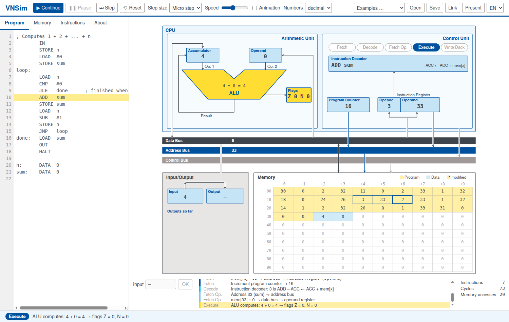

# VNSim – Von Neumann Simulator

*English · [Deutsch](README.de.md) · [Français](README.fr.md) · [Español](README.es.md)*

**▶ Try it: <https://sc-sgs.github.io/vnsim/>** (no installation, runs in any modern browser)

VNSim is an interactive model computer for teaching computer architecture. A simple
accumulator machine following the von Neumann architecture is shown as a diagram; every
instruction runs visibly through the five phases
**Fetch → Decode → Fetch Operands → Execute → Write Back** as a sequence of micro steps,
with values travelling over data, address and control bus.

Developed for the lecture “Informatik für Ingenieurwissenschaften” (Computer Science for Engineers)
at the University of Stuttgart.

The user interface is available in **English and German**, and also in French and Spanish (switch at the
top right, or use `?lang=en`, `?lang=de`, `?lang=fr`, `?lang=es` in the URL).



## Features

- Program and data share **one memory** (von Neumann principle) – programs can even modify themselves.
- Step through the execution by micro step, phase or instruction, or run with adjustable speed and animation.
- Memory cells can be edited directly; a disassembly column shows how each cell is interpreted.
- Numbers in decimal, hexadecimal or binary (16-bit two's complement).
- Counters for instructions, clock cycles (micro steps) and memory accesses – to compare the cost of programs.
- Share programs as links (`…/vnsim/#p=…`), e.g. on slides, QR codes or exercise sheets.
- Example programs: expression from the lecture, maximum, countdown, sum 1 … n, factorial,
  self-modifying list sum.
- Presentation mode for projectors (key **P**).
- Works offline: just open `index.html` – no build step, no dependencies.

## The machine

- 100 memory cells (addresses 0 … 99), each holding an integer from −9999 to 9999.
- An instruction occupies two cells (opcode, operand).
- Registers: accumulator (ACC), operand register, flags **Z** (zero) and **N** (negative),
  program counter, instruction register, input and output register.

### Instruction set

| Code | Instruction | Effect | sets |
|---|---|---|---|
| 00 | `HALT` | Stop the program |  |
| 01 | `LOAD x` | ACC ← mem[x] |  |
| 11 | `LOAD #n` | ACC ← n |  |
| 02 | `STORE x` | mem[x] ← ACC |  |
| 03 | `ADD x` | ACC ← ACC + mem[x] | Z N |
| 13 | `ADD #n` | ACC ← ACC + n | Z N |
| 04 | `SUB x` | ACC ← ACC − mem[x] | Z N |
| 14 | `SUB #n` | ACC ← ACC − n | Z N |
| 05 | `MUL x` | ACC ← ACC · mem[x] | Z N |
| 15 | `MUL #n` | ACC ← ACC · n | Z N |
| 06 | `DIV x` | ACC ← ACC // mem[x] | Z N |
| 16 | `DIV #n` | ACC ← ACC // n | Z N |
| 07 | `MOD x` | ACC ← ACC % mem[x] | Z N |
| 17 | `MOD #n` | ACC ← ACC % n | Z N |
| 08 | `CMP x` | Flags ← ACC − mem[x] (ACC unchanged) | Z N |
| 18 | `CMP #n` | Flags ← ACC − n (ACC unchanged) | Z N |
| 20 | `JMP target` | Always jump |  |
| 21 | `JE target` | Jump if equal (Z = 1) |  |
| 22 | `JNE target` | Jump if not equal (Z = 0) |  |
| 23 | `JL target` | Jump if less (N = 1) |  |
| 24 | `JLE target` | Jump if less or equal (N = 1 or Z = 1) |  |
| 25 | `JG target` | Jump if greater (N = 0 and Z = 0) |  |
| 26 | `JGE target` | Jump if greater or equal (N = 0) |  |
| 30 | `IN` | ACC ← input |  |
| 31 | `OUT` | output ← ACC |  |

ACC = accumulator, mem[x] = contents of cell x. DIV and MOD work like `//` and `%` in Python.
HALT has opcode 00 – so empty memory halts immediately.

Immediate values (`#n`) use opcode + 10. The flags are set by ADD, SUB, MUL, DIV, MOD and CMP,
but not by LOAD and IN (like `mov` on x86).

**Input and output** go through the accumulator like all data: `IN` followed by `STORE x` stores an
input value, `LOAD x` followed by `OUT` outputs a memory cell.

**Rule of thumb:** put a `CMP` before every conditional jump – then it is clear what the jump refers to.
Since arithmetic instructions also set the flags, the `CMP` can sometimes be omitted (e.g. `SUB #1`
directly before `JG`, see the “Countdown” example); this saves an instruction but is easier to overlook.

### Assembler directive `DATA`

`DATA` is not a machine instruction but a directive for the assembler: `name: DATA v1, v2, …`
places the values in the next free memory cells; `name` is the address of the first cell.
The machine itself does not know `DATA` – if such a cell is executed as an instruction, its value
is taken as an opcode.

**Naming a memory cell:** `b: DATA 0` reserves the next free cell with initial value 0 and gives it
the name `b`, similar to a variable. Afterwards you can write `b` instead of the address everywhere,
e.g. `LOAD b`, `STORE b`, `ADD b`; the assembler fills in the address.

### Colours in memory

| Colour | Meaning |
|---|---|
| yellow | instruction (opcode, operand) – produced by the assembler or fetched as an instruction at run time |
| blue | data – created with `DATA` or written at run time (`STORE`) |
| yellow with blue corner | program cell overwritten at run time (self-modifying code) |

Bright yellow marks the access of the current micro step (red border when writing); a thick blue
border marks the cell the program counter points to.

### Syntax

```
; comment
start:  LOAD  #5      ; immediate value
        ADD   x       ; value at address x
        STORE 42      ; address as a number
        STORE x+1     ; the cell after x
        JMP   start
x:      DATA  7, 8    ; data cells
```

A number without `#` is an **address** – write `#2` for the number 2 (`MOD 2` uses the contents of
cell 2). Upper and lower case are treated the same; labels start a line and end with `:`.

## Usage

| | |
|---|---|
| **▶ Start** | run until HALT (F5) |
| **⏭ Step** | one micro step, phase or instruction, see “Step size” (F10) |
| **Pause / Reset** | Space / Esc |
| **Link** | copies a link containing the current program |
| **Present** | presentation mode (P) |

Tabs on the left: **Program** (editor), **Memory** (edit cells, disassembly), **Instructions**
(instruction reference), **About** (information on the simulator).

The program is also kept in the browser's local storage.

## Development

Plain HTML, CSS and JavaScript without dependencies or build step; `index.html` must keep working
when opened via `file://`. Main files:

| File | Purpose |
|---|---|
| `js/isa.js` | instruction table |
| `js/assembler.js` | source code → memory image |
| `js/machine.js` | machine state and instruction cycle as micro steps (no DOM) |
| `js/view.js` | SVG diagram and animation |
| `js/app.js` | user interface |
| `js/i18n.js` | texts in all languages |
| `js/examples.js` | example programs (all languages) |

Tests: open `tests/index.html` in a browser, or headless:

```sh
chromium --headless --dump-dom "file://$PWD/tests/index.html" | grep -o 'id="summary"[^<]*'
```

## Author and license

Dirk Pflüger, University of Stuttgart.

Code: [MIT License](LICENSE). Font: TeX Gyre Heros, GUST Font License (see `fonts/`).
